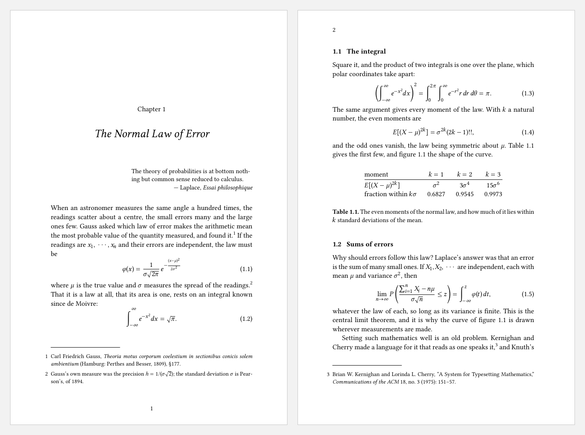
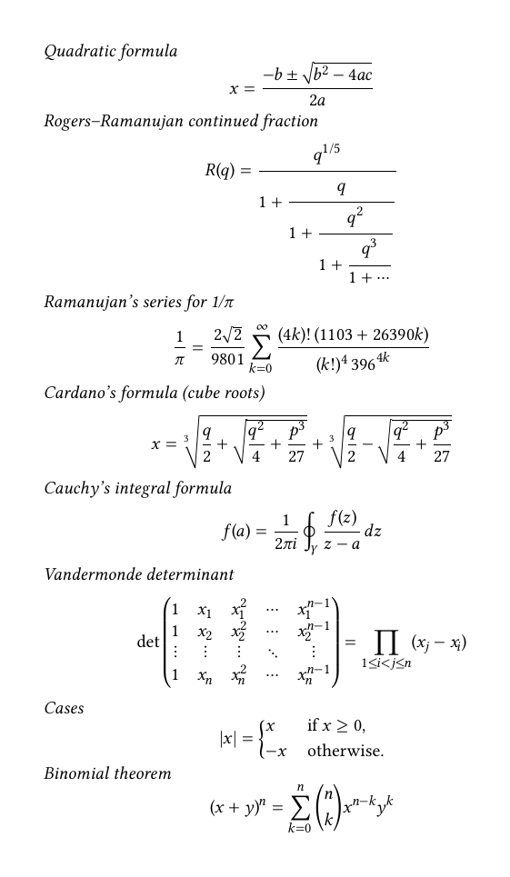
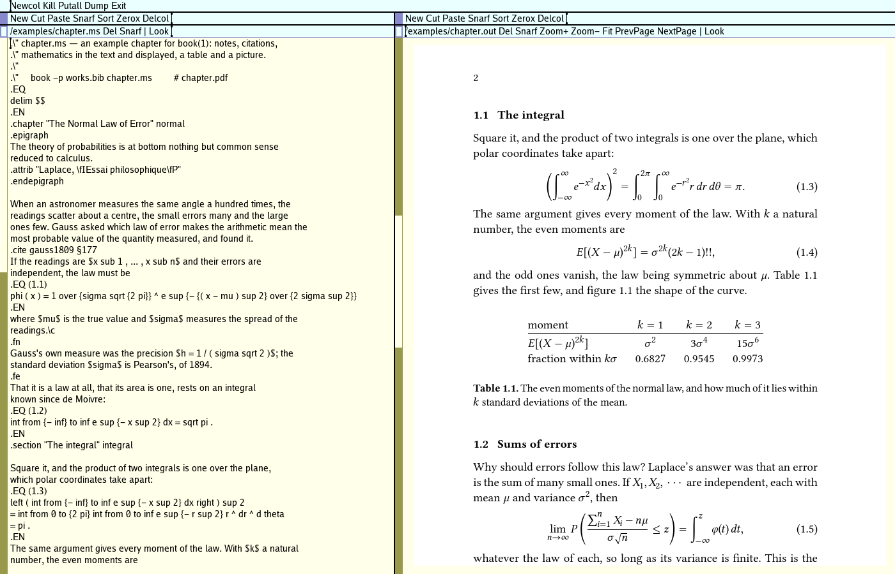
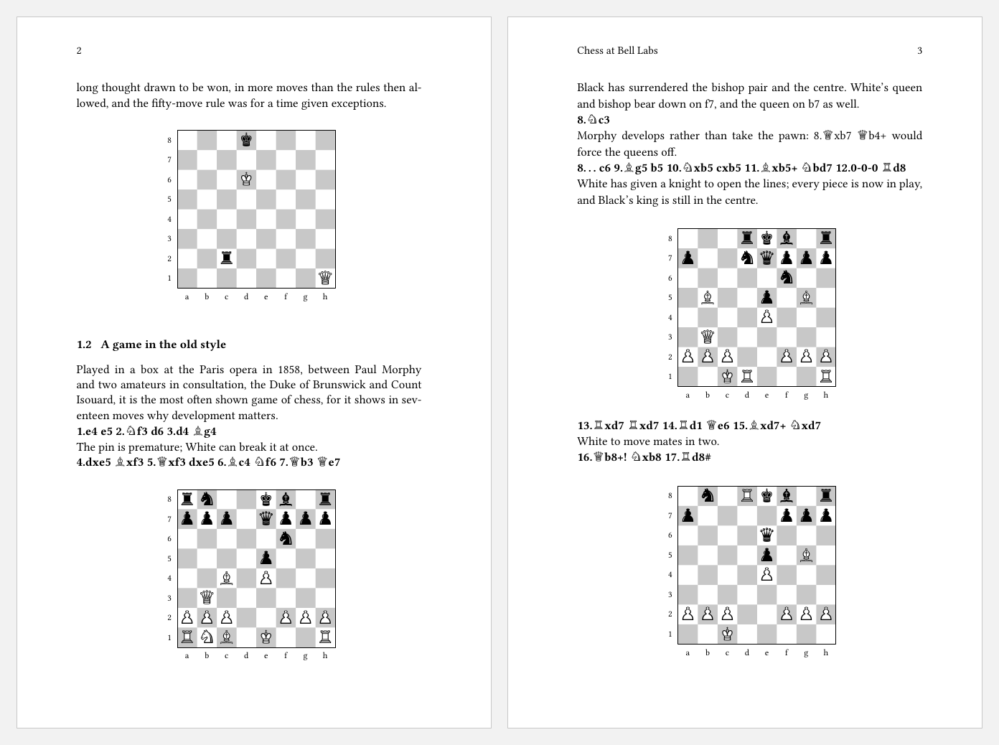

# troff for InferNode

A typesetting system for books, for [InferNode](https://github.com/infernode-os/infernode):
troff and its preprocessors (eqn, tbl, pic, refer, chess), PDF output (tr2pdf),
macro packages for books (`-mbook`), papers (`-ms`) and manual pages
(`-man`), an index maker, a LaTeX converter, and the Libertinus fonts.



*Two pages of [`examples/chapter.ms`](examples/chapter.ms), set by
`book -p works.bib chapter.ms` ([the PDF](examples/chapter.pdf)).*

This is an add-on, not a copy of InferNode. It changes nothing in
InferNode: it is built into its own `dis/`, and put into a name space
by binding its directories after InferNode's own.

Tested in Xenith.app 0.8.0. It needs InferNode from 14 October 2026 or later
(`af0acc617`): Xenith's document engine interface, `docengine(2)`,
gained `pinned` and `viewing` then.

## What it sets

- **Text.** Whole paragraphs are broken at once, as TeX breaks them, not
  line by line; spaces are kept even, hyphens few and never more than
  three lines running. Widows and orphans are kept from pages' edges, and
  a page left short has its space spread so that it ends where a full
  page does. `book -f` hangs punctuation and hyphens into the margins,
  and lets a line's letters widen or narrow by up to 2% to even its
  spacing, as LaTeX's microtype does. The face is Libertinus Serif, its
  ligatures and small capitals from the font's own OpenType tables.
- **Mathematics.** eqn's language (`x sup 2`, `{a + b} over 2`,
  `sum from {i = 1} to n`), set by TeX's rules for placing each part, in
  Libertinus Math. The font's MATH table supplies the parameters, maths
  italic letters and their corrections, accents, and the sizes and
  pieces of brackets, braces and radicals. Displays are numbered, lined
  up on a sign, or set as cases and matrices.
- **A book's apparatus.** Chapters, sections, contents, footnotes and
  endnotes, cross-references by label, figures and tables that float,
  lists, quotations and epigraphs, a bibliography from a BibTeX file in
  Chicago's style (or others), and an index.
- **Tables, pictures and images.** tbl's tables, pic's drawings, PNG and
  JPEG images, and the first page of a PDF as a figure in vectors.
- **An accessible PDF.** The PDF is tagged and claims PDF/UA-1, and
  veraPDF agrees: headings, paragraphs, notes, lists, tables, figures
  with their descriptions, links, the bibliography and the index are its
  structure, read in order. Each equation is described in words, as a
  screen reader would speak it ("x equals the fraction with numerator
  minus b plus or minus the square root of b squared minus 4 a c, end
  root, and denominator 2 a").
- **Chess.** Diagrams from a position in Forsyth–Edwards notation, and
  moves in figurine notation (♘f3) in the text, by `chess`.
- **LaTeX for a publisher.** `book2tex` writes the same book as LaTeX,
  for a publisher who wants it.



*Displays known to be hard to set, from
[`examples/maths.ms`](examples/maths.ms) (`book maths.ms`;
[the PDF](examples/maths.pdf)).*

## Writing a book

A book is a text file of troff with `-mbook`'s macros. This is the
start of [`examples/chapter.ms`](examples/chapter.ms):

```troff
.EQ
delim $$
.EN
.chapter "The Normal Law of Error" normal
.epigraph
The theory of probabilities is at bottom nothing but common sense
reduced to calculus.
.attrib "Laplace, \fIEssai philosophique\fP"
.endepigraph

When an astronomer measures the same angle a hundred times, the
readings scatter about a centre, the small errors many and the large
ones few. Gauss asked which law of error makes the arithmetic mean the
most probable value of the quantity measured, and found it.
.cite gauss1809 §177
If the readings are $x sub 1 , ... , x sub n$ and their errors are
independent, the law must be
.EQ (1.1)
phi ( x ) = 1 over {sigma sqrt {2 pi}} ^ e sup {- {( x - mu ) sup 2} over {2 sigma sup 2}}
.EN
where $mu$ is the true value and $sigma$ measures the spread of the
readings.\c
.fn
Gauss's own measure was the precision $h = 1 / ( sigma sqrt 2 )$; the
standard deviation $sigma$ is Pearson's, of 1894.
.fe
```

Mathematics goes between `.EQ` and `.EN`, or within a line between the
delimiters `delim` names; `.EQ (1.1)` numbers a display. `.cite` takes
a key from the bibliography (`works.bib`) and a place in the work, and
makes a note in Chicago's style. A table is tbl's, inside a floating
`.table`:

```troff
.table moments
.TS
center;
l c c c.
moment	$k = 1$	$k = 2$	$k = 3$
_
$E [ ( X - mu ) sup {2 k} ]$	$sigma sup 2$	$3 sigma sup 4$	$15 sigma sup 6$
fraction within $k sigma$	0.6827	0.9545	0.9973
.TE
.caption "The even moments of the normal law, and how much of it lies within $k$ standard deviations of the mean."
.endtable
```

and a picture is pic's, or an image or a PDF, inside a `.figure`:

```troff
.figure curve
.alt "The bell curve of the normal law, its mean marked and one standard deviation either side."
.PS
spline from (-2.5, 0.07) to (-1, 0.97) to (0, 1.6) to (1, 0.97) to (2.5, 0.07)
.PE
.caption "The normal law: two thirds of it within one standard deviation of the mean."
.endfigure
```

`.alt` describes it for those who cannot see it. Then:

    book -p works.bib chapter.ms     # chapter.pdf, tagged (PDF/UA-1)

`book` runs refer, pic, tbl and eqn once, then troff as often as the
contents, references and index need, then tr2pdf. `-f` sets the book as
it goes to press, with the margins' hanging punctuation. The pieces run
on their own as well:

    tbl paper.ms | eqn /lib/troff/eqnrc - | troff -ms | tr2pdf >paper.pdf
    troff -man /man/1/troff | tr2pdf >troff.pdf
    book2tex -p works.bib -o book.tex book.ms    # the same book as LaTeX

`man book`, `man 6 troff`, `man troff` and `man eqn` describe it all;
[`docs/TROFF.md`](docs/TROFF.md) is the design, and records what each
choice was measured against.

## In Xenith

Xenith shows troff's output as a typeset document beside its source:
the same pages as the PDF, painted from troff's output by the package's
document engine. Here the chapter's source is on the left; on the right,
its second page.



Put the build in the source window's tag (`book -p works.bib
chapter.ms`) and open the output (`chapter.out`) in another window.
After each Put, middle-click the build, then Get in the output's window.
Zoom+, Zoom−, Fit, PrevPage and NextPage move about the document, and
its text can be searched. The screenshot is in Xenith's Glenda theme
(`xenith -t glenda`). Setting Xenith up for it is under
[Xenith](#xenith) below.

## Chess

`chess` sets a board between `.CB` and `.CE` from its position in
Forsyth–Edwards notation, the notation databases and engines write:

    .CB
    fen rn2kb1r/ppp1qppp/5n2/4p3/2B1P3/1Q6/PPP2PPP/RNB1K2R w
    .CE

The board is a picture, so `-mbook` centres it, keeps it on one page and
tags it as a Figure in the PDF. Its description is the position read
out ("Chess diagram. White: King e1, Queen b3, Rooks a1 and h1, …
White to move."), unless `.alt` gives another. `size`, `flip` and
`nocoords` change a board's size, turn it for Black, and leave its
squares unnamed. The pieces are the Unicode chess figures, from a subset
of Noto Sans Symbols 2 (`fonts/chess`, under the OFL). The same figures
set moves in the text: `\fB7.♕b3 ♕e7\fP`. `book` runs `chess` when a
book has a board.



*Pages 2 and 3 of [`examples/chess.ms`](examples/chess.ms) (`book
chess.ms`; [the PDF](examples/chess.pdf)): Belle and Thompson's
endgame databases, then Morphy's Opera Game of 1858.*

## Benchmarks

Measured on a 2.1 GHz Xeon (Linux, amd64), InferNode's JIT (`emu -c1`),
but for the rows marked †, measured on a 2.8 GHz Xeon (`docs/TROFF.md`).

| | troff for InferNode | for comparison |
|---|---|---|
| 245-page book of mathematics (`tools/mathbook.py`: 1,440 inline equations, 360 displays), from nothing | 13.5 s (two passes) | XeLaTeX on `book2tex`'s LaTeX: 2.3 s a pass |
| the same, rebuilt after an edit | 9.1 s (one pass) | |
| 235-page doctoral dissertation (notes in Chicago's style, figures), `book -f` | 12.7 s | |
| the same dissertation † | 12 s | XeLaTeX: 40 s (three passes and biber) |
| 23 hard displays (`tests/eqn/hard.ms`), emulator start included † | 0.6 s | XeLaTeX, one pass: 0.8 s |
| 62-page `-ms` paper, one troff pass † | 1.36 s | C Neatroff: 0.58 s |
| PDF/UA-1 (veraPDF) | conforms | LaTeX's default output is untagged |

LaTeX is faster on a long book full of mathematics; troff for InferNode
runs as Dis bytecode, and much of its time there is the virtual
machine's own (reference counting, calls, allocation). On a thesis of
prose and notes, it is faster: one run of `book` against three of
XeLaTeX and one of biber.

The quality of the text, on 180 pages of this tree's prose, against
LuaLaTeX with microtype on the same pages:

| | mean space | 95th percentile | lines looser than 0.5 em | lines hyphenated | two hyphens running |
|---|---|---|---|---|---|
| troff for InferNode (`book -f`) | 0.27 em | 0.38 em | 21 | 10% | 32 |
| LuaLaTeX, microtype | 0.28 em | 0.35 em | 25 | 8% | 28 |

And the mathematics: on the 23 hard displays, every part is placed
where XeLaTeX with `unicode-math` and Libertinus Math places it, to a
fraction of a point (`tests/host/maths_test.sh` checks each).

## Installing

You need a built InferNode, since the package is built with its `mk`
and `limbo`. On the host:

```sh
git clone https://github.com/pdfinn/infernode-troff troffpkg
cd troffpkg
export ROOT=/path/to/infernode
export PATH=$ROOT/MacOSX/arm64/bin:$PATH   # or Linux/amd64, and so on
mk install
```

This builds into `dis/` inside this tree. Nothing is copied into
InferNode: `ROOT` gives the build InferNode's `mkconfig` and modules
(`$ROOT/module`), and nothing is written there. On a Mac with
plan9port, InferNode's `mk` must come before plan9port's on the path.

`ROOT` is the InferNode the package is to run in. For an installed
Xenith.app, that is its runtime tree, with `mk` and `limbo` from a built
InferNode source tree:

```sh
export ROOT=/Applications/Xenith.app/Contents/Resources
export PATH=/path/to/infernode/MacOSX/arm64/bin:$PATH
mk install
```

After InferNode changes a module the package uses, build again from
clean: `mk nuke` and `mk install`.

Inside InferNode, bind it in:

```
run /n/local/path/to/troffpkg/troffns
```

`troffns` binds each of the package's directories after InferNode's
own (`bind -a`): the commands to `/dis`, the macros and device
descriptions to `/lib/tmac` and `/lib/troff`, the fonts to
`/fonts/libertinus`, the manual to `/man`. Nothing of InferNode's is
hidden. Run it with `run`, so that the binds are made in the calling
shell's name space. In a running Xenith, `Local run
/n/local/path/to/troffpkg/troffns` makes them in Xenith's own name
space, for every command run from it after. Put that line in your
profile to have troff in every session; delete it to remove it.

## Xenith

Xenith shows troff's output (`x T` in its first bytes) as a typeset
document, through the engine `dis/xenith/doc/trodoc.dis`. Xenith finds
engines through `/lib/xenith/doctypes`, which is InferNode's; add these
two lines to it:

    troff	binary	/dis/xenith/doc/trodoc.dis	magic=x\x20T\x20
    roff	source	/dis/xenith/doc/trodoc.dis	.ms .mm .me .man .roff .tr .t

Xenith reads `doctypes` once, when it starts, so add the lines before
starting it. The engine is loaded the first time a troff document is
opened, from Xenith's name space: `troffns` run in the shell that
starts Xenith, or later with `Local`, as above.

A document is built, then viewed: its pipeline (refer, pic, tbl, eqn,
then troff, as often as its contents and index need) makes troff's
output, and Xenith shows that. Put the build in the source window's
tag, `book book.ms`, or a pipeline, `tbl paper.ms | troff -ms
>paper.out`, and open the output, `book.out` or `paper.out`, in another
window. After each Put, middle-click the build, then Get in the
output's window.

Render, on a `.ms` or `.man` file, sets it with `troff` and the macro
package its name gives, once and with no preprocessor: for simple
documents only.

## Not yet

- The tests in `tests/` were written to run inside an InferNode tree
  and have not yet been made to run against the package.

## Licence

MIT (`LICENSE`). The programs translated from Neatroff, Neateqn,
Neatrefer, Neatpost and Neatmkfn (Ali Gholami Rudi, ISC) and from Plan 9's
tbl and pic keep their notices in their sources; the macros' are in
`lib/tmac/NOTICE`, the hyphenation patterns' in `lib/troff/hyph/NOTICE`,
the fonts' in `fonts/libertinus/OFL.txt`.
